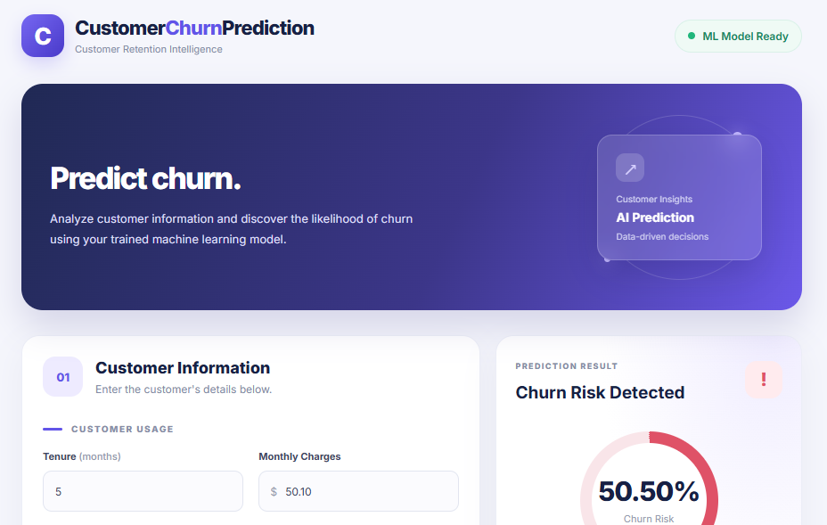
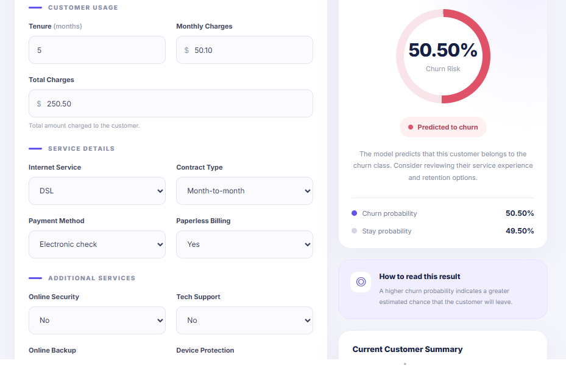
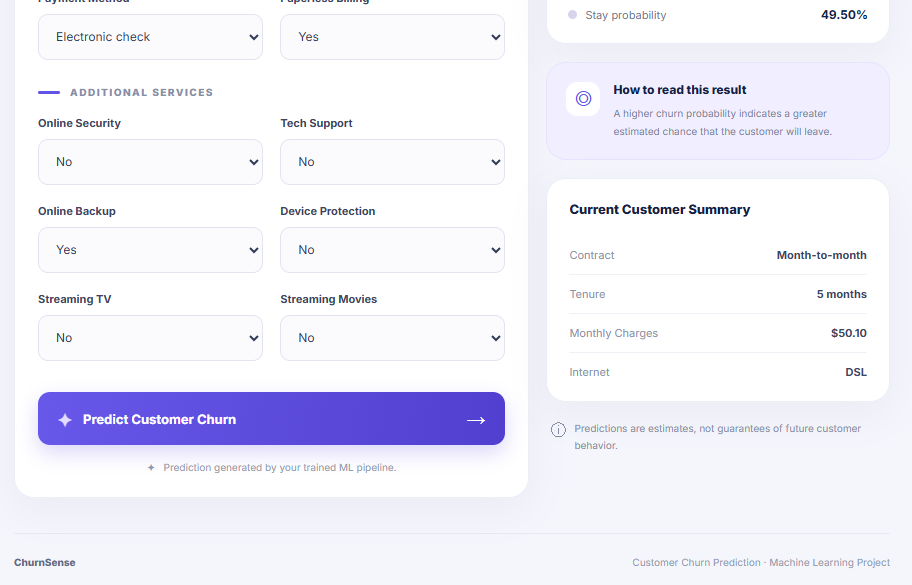

# Customer Churn Prediction

This project predicts whether a customer is likely to leave a service using Machine Learning.

Deployment URL :  https://customer-churn-prediction-dh6t.onrender.com
### Features

* Customer churn prediction using a trained ML model.
* Flask backend for predictions.
* HTML and CSS frontend for user interaction.

### Technologies Used

* Python, Pandas, NumPy, Scikit-learn
* Flask, HTML, CSS
* Jupyter Notebook

### How to Run

1. Install dependencies
2. Run the Flask app: `python backend/app.py`
3. Open the local URL shown in the terminal.

**Goal:** Help businesses identify customers at risk of leaving and improve customer retention.

